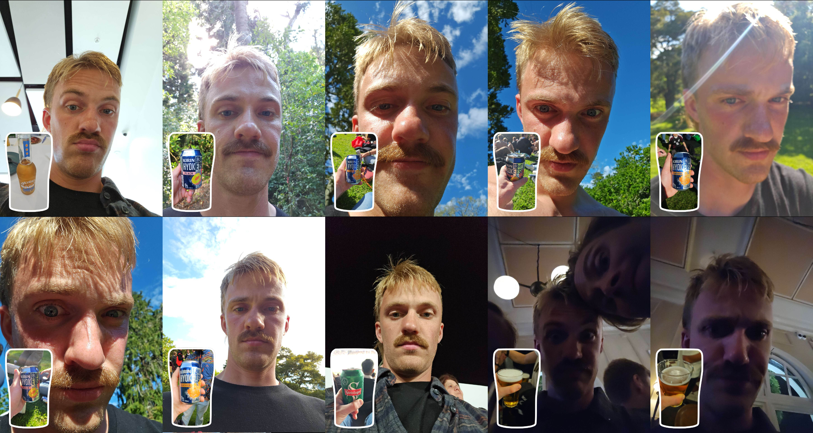

# Smidig feltarbeid og passende feiring

I går så jeg New Zealand og Australia spille rugbykamp. De var flinke til å spille rugby. Det var også en gyllen mulighet til å gjøre litt smidig feltarbeid. Bildet under er fra kampen og viser hvordan knallhard scrumming ser ut i praksis. Den observante leser legger kanskje merke til et Kanban-board baki der også. Det er godt å se programvareutviklere også kan drive med idrett av og til. New Zealand vant 50-19. Aldri i tvil.

Andre viktige observasjoner er at alle spillerne hadde like sko og at alle spillerne er helt usaklig store. Som om de ikke har hørt om standardavvik engang. Standardavviksmelding på hele gjengen. Jeg lurer på hva FPU synes om denne idretten, med tanke på at de ikke liker avviksmeldinger så godt. Og hva de synes om smidig utvikling. Mitt gjett er at de liker rugby, sånn at de endelig kan få lov til å kose litt med guttene uten alt det kjipe stigmaet om å ikke være heterofil og sånn. Og så tror jeg ikke de vet hva smidig utvikling er. Kanskje de burde ta litt utdanning.

Naturligvis måtte denne seieren feires både på forskudd og etterskudd. Her er oppsummering av feiringen. Hvis du vil ha disse vakre bildene i sanntid rett i mobilen bruk denne linken: [beerbuddy.app.link/andersfangel_6902](https://beerbuddy.app.link/andersfangel_6902).

