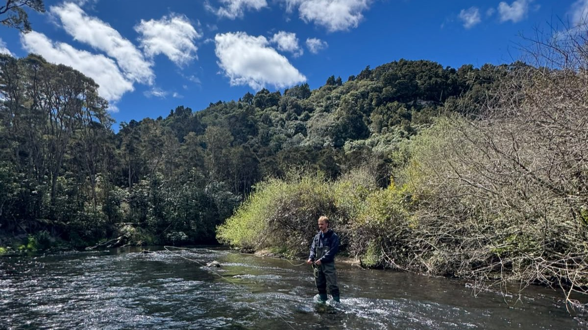
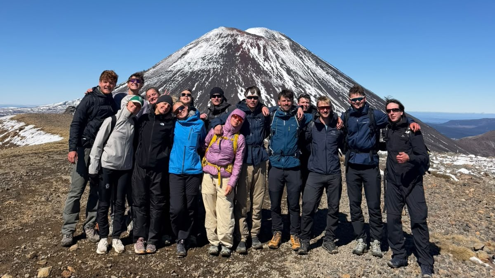
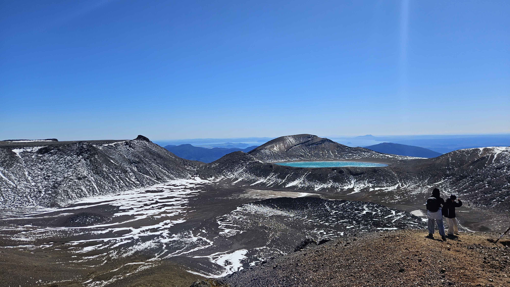

# Tur til Turangi

Denne helgen dro jeg til Turangi. 

På fredag prøvde jeg fluefiske for første gang. Turangi er fluefiskehovedstaden i New Zealand, og jeg er fryktelig glad jeg ikke kom dit med en haspelstang. Det hadde vært flaut. Jeg kom faktisk ikke med noen stang, men kunne leie på nærfiskebutikken.

På lørdag prøvde jeg fluefiske for andre gang. 

Fikk jeg fisk? Nei. Hadde jeg det gøy? Nei. Var det fint vær? Nei. Var det deilig å være ute? Nei. 

På søndag gikk jeg det som skal være New Zealands beste dagstur. Den heter Tongariro Crossing, og den var absolutt en veldig bra dagstur. For å nok en gang bevise for min skeptiske mor at jeg har venner, her er turfølget foran Mount Doom. 

På et tidspunkt tok jeg bildet under. Jeg syntes hvertfall det var ganske fin utsikt. Denne dagen var mye bedre enn de skikkelig dårlige dagene fredag og lørdag, hvor jeg ikke hadde det noe gøy på noe tidspunkt.

