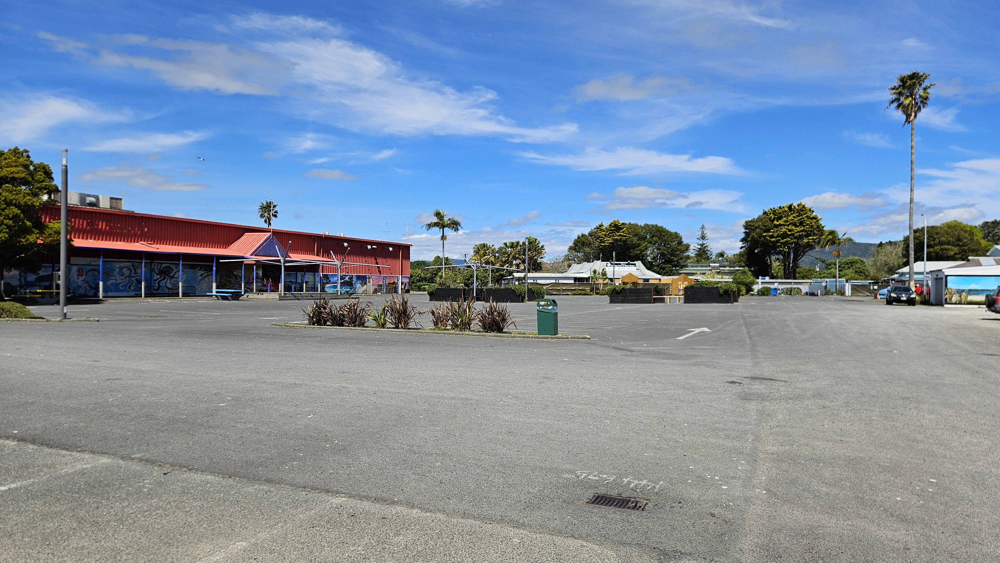
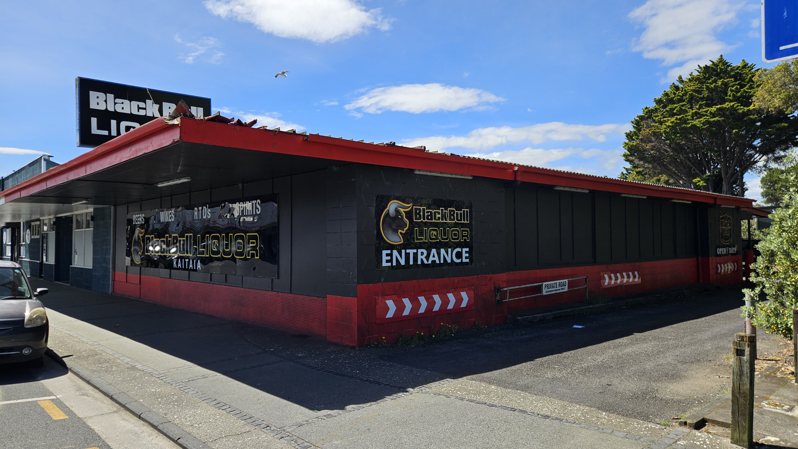
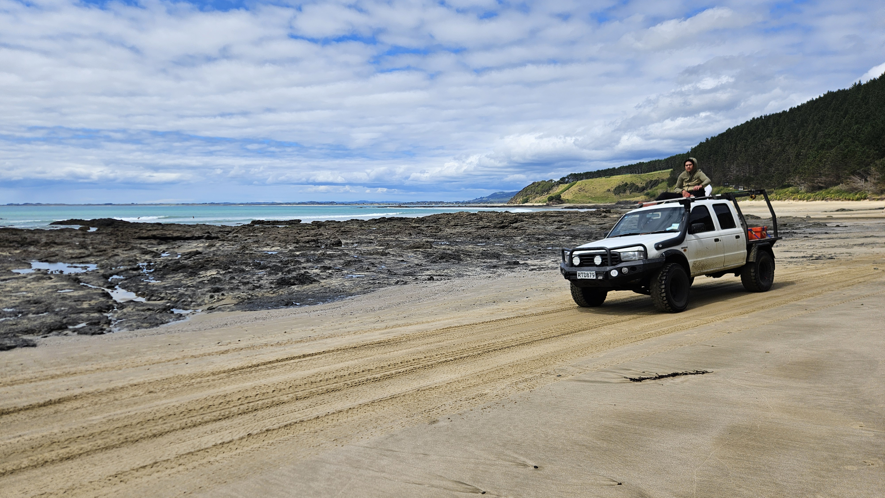
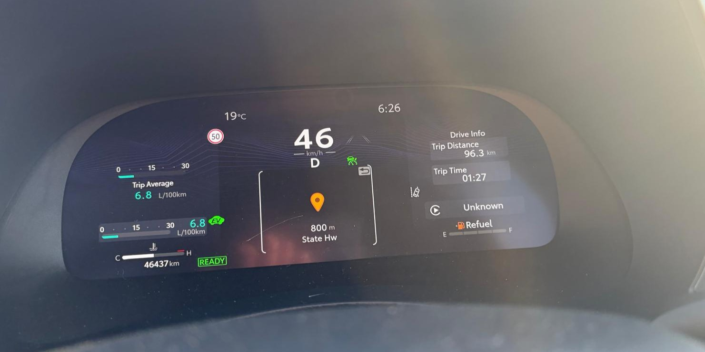

# Oppsummering av helgen

Denne helgen har jeg vært på litt sightseeing helt nord i New Zealand. Under er noen høydepunkter

Her er en stor åpen plass. Denne ligger en gate ovenfor handlegaten i den noe ukjente byen Kaitaia. Her var det ingen mennesker, bortsett fra en enslig mann som syklet sakte over plassen på en altfor liten sykkel. Det eneste som mangler nå er lavt skydekke og nedlagt badeland.

I den samme byen har de også drive-through spritbutikk. Om ikke det er et salgbart konsept vet ikke jeg. Her har Vinmonopolet virkelig noe å lære. 

Taliban. De er tydeligvis i New Zealand også.

Det ble ganske mange timer i bil i løpet av helgen også. For eksempel brukte vi 14 timer på en 5 timer lang kjøretur på lørdag. Og på søndag trillet vi inn på bensinstasjonen med det Toyota mener er 0 km rekkevidde igjen. Var det litt stressende å ha 5 km på rekkeviddemåleren og 8 km til nærmeste bensinstasjon? Selvfølgelig ikke. Du trenger ikke marginer om du har selvtillit.

