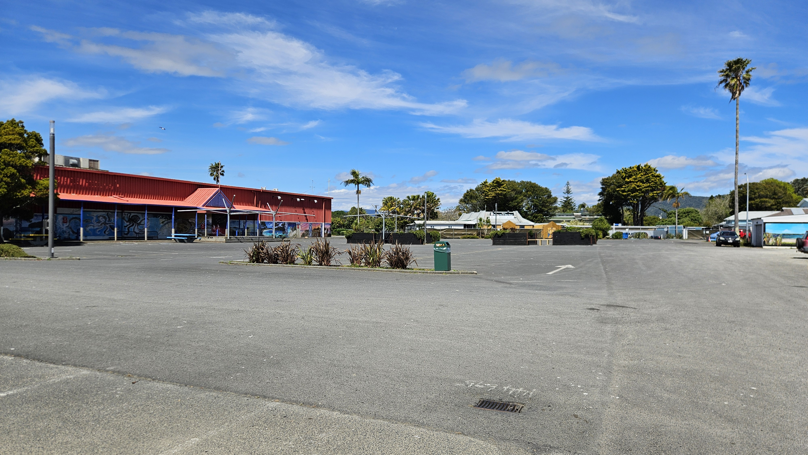
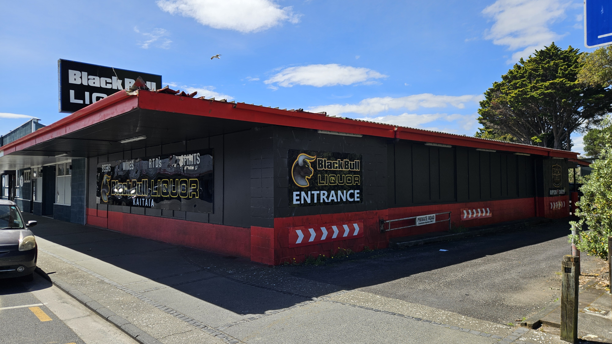
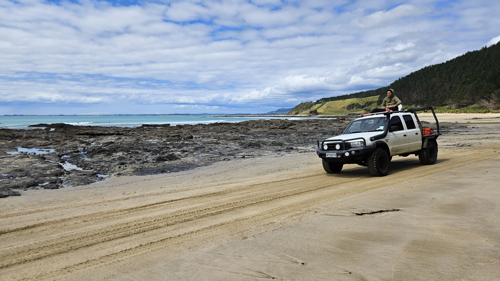
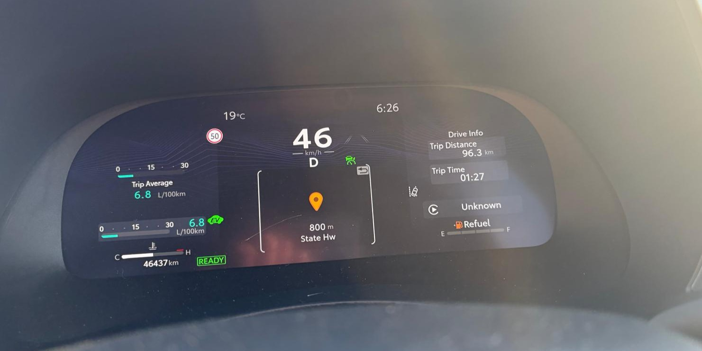

# Summary of the weekend

This weekend I went for some sightseeing all the way north in New Zealand. Below are some highlights. 

Here is a large open area. It was located one street above the shopping street in the somewhat unknown town of Kaitaia. There were no people here, except a lonely man who slowly rolled across the tarmac on a bicycle that was way too small. The only thing missing was low cloud cover and an abandoned water park.

In the same town they also have a drive-through liquor store. If that is not a sellable concept then I don't know. Vinmonopolet definitely has something to learn here. 

Taliban. They are apparently in New Zealand too.

We tallied up quite a lot of hours in the car during the weekend. For example did we manage to spend 14 hours on a 5 hour drive on Saturday. And on Sunday, we rolled into the gas station with what Toyota said was 0 km of range. Was it stressful to have 5 km on the rangemeasurement thing and 8 km to the closest gas station? Of course not. You don't need margins when you have confidence.

