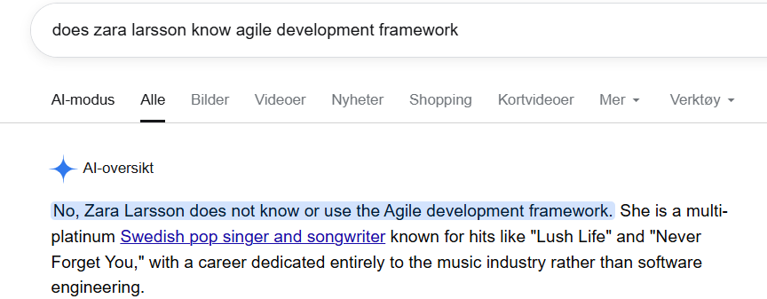
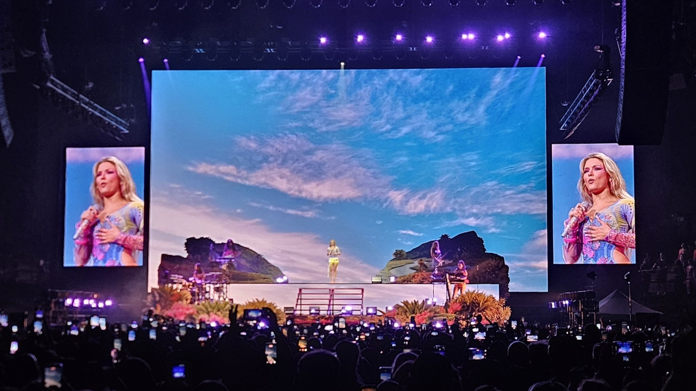
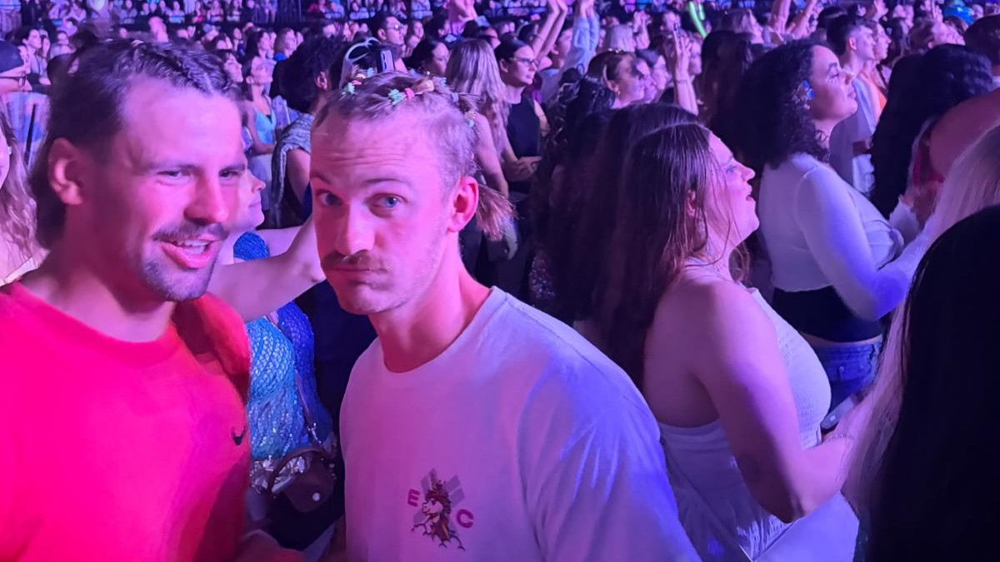

# Zara Larsson-concert

Yesterday I saw Zara Larsson. She singed(?) and danced well, good thing she chose that as her job, instead of something she not quite as good at. 

But does Zara look a little like Sylvi Listhaug here?

The highlight of the concert was when someone in the beer line said to me "Wow! I **LOVE** your hair!". Ehm thanks??? In my shocked state I didn't produce a single compliment back. Terrible performance.

The bottom point was when the AI-beer scanner in the beer checkout couldn't scan my beer. And the beer buying customer service person who was supposed to help with beer-related problems couldn't do it either. So then there was no beer for me. My present flaming rage stoppet me from remembering to take a picture. Sorry. AI is the future. Invest now.