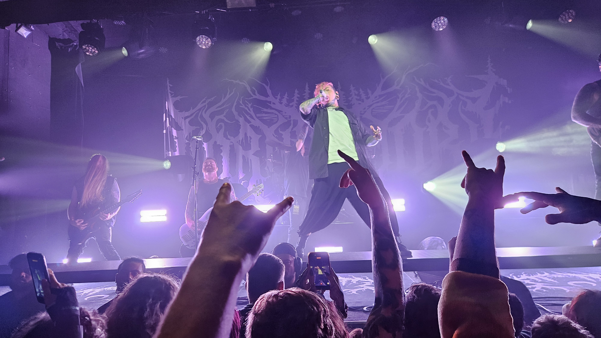

# Lorna Shore-konsert

På mandag var det lettfordøyelig, trivelig elektropop. På onsdag var det dum huleboermusikk. Oppvarming var Organectomy, det kjente slam-bandet fra Christchurch. Neste oppvarming var The Acacia Strain, som sa det var viktig å dra på små, lokale konserter. Headliner var Lorna Shore, og de var flinke til å skrike og spille fort på instrumentene sine.

Varm opp med *Lush Life* av Zara Larsson, og gå videre *Through the Hellfire* av Lorna Shore. Da kan dere også få sjangerwhiplash sånn som meg.