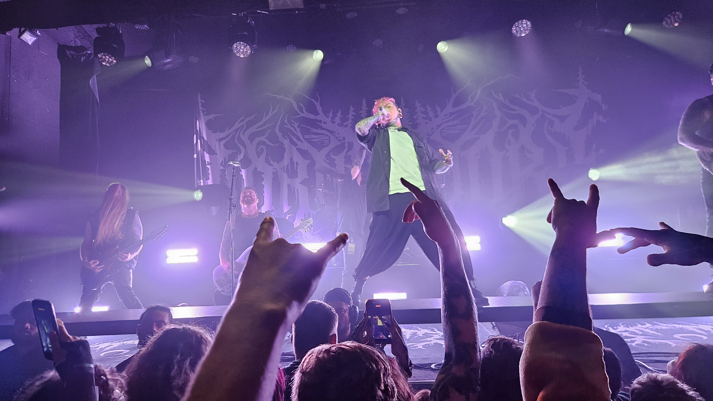

# Lorna Shore-concert

On Monday there was easy-listening electropop. On Wednesday there was caveman music. Warm-up was Organectomy, the famous slam-band from Christchurch. Next warm-up was The Acacia Strain, who said it was important to go to small, local concerts. Headliner was Lorna Shore, and they were quite good at screaming and playing fast at their instrument.

Start by listening to *Lush Life* by Zara Larsson, then continute with *Through the Hellfire* by Lorna Shore. Then you can also get genre whiplash like me.