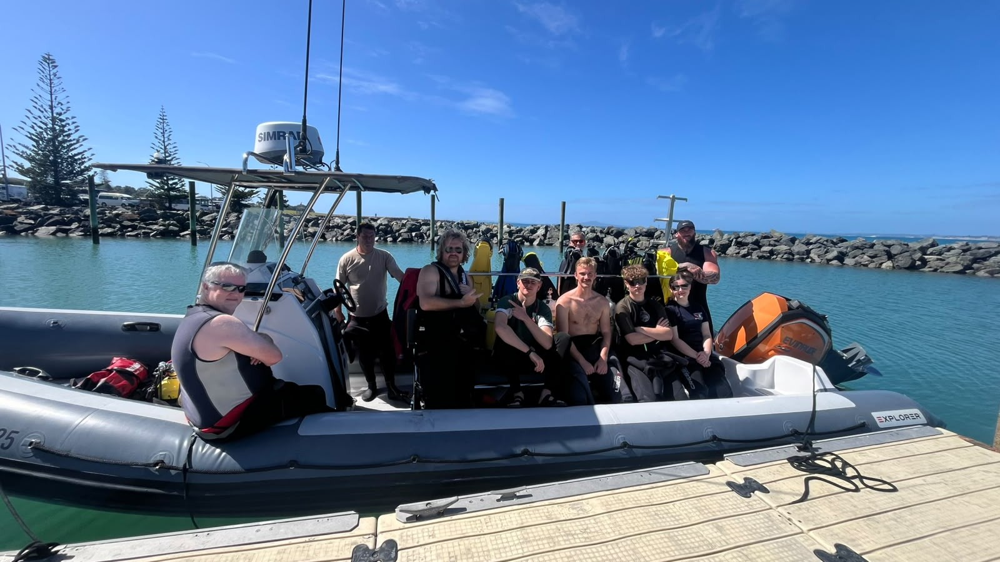

# Another diving course

I won't bother writing an obnoxious LinkedIn-post this time, but would like to inform the blog that I have done another diving course. Now I am officially certified Advanced Open Water Diver. Or something like that. So if anyone wants to dive with me, just raise your hand. I am also the proud owner of my own mask and a sunburnt face.

These were the participant on the course. Or rather, the two on the left just joined the boeat, and number three was the instructor. The rest were participants. You may notice the one giant, I think he's the one from Paradise