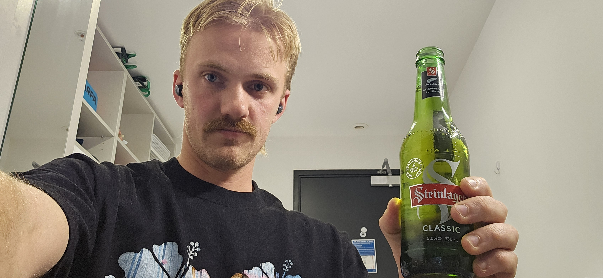

# Done

I have officially submitted my final submission for the semester. It was a presentation about a discretized extended Kalman filter. Let me know if anyone is interested in hearing more about that. In general, the semester has been a big academic success. I have presumably passed all my courses, and that is quite good. 

Finally vacation. Done. Cheers!