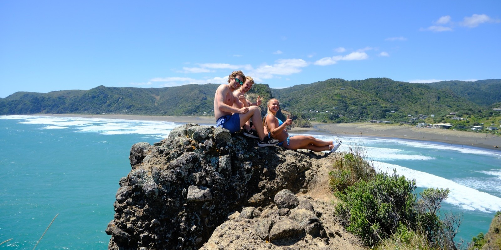
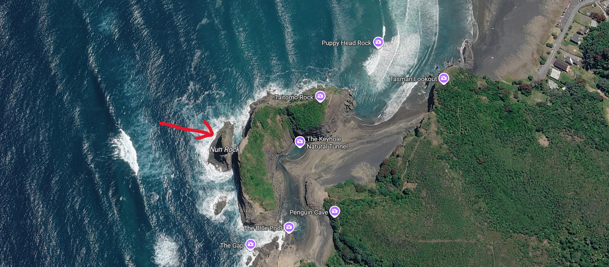
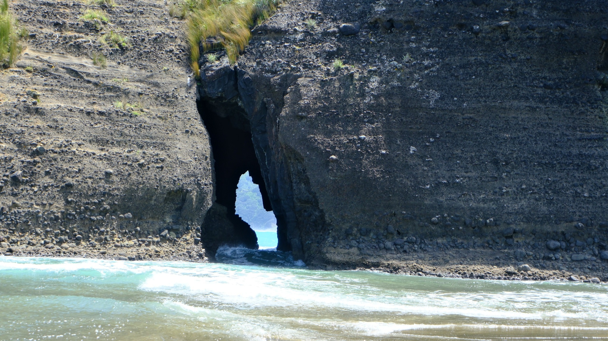

# Var på stranden i dag

Jeg var på stranden i dag. Det var ganske bra. Jeg regner egentlig med at de fleste har vært på stranden før, men om det skulle være noen tvil så har jeg badet, drukket brus, hørt på musikk og lekt med ball. Det er liksom ikke så veldig mye mer som skal til. Det hadde kanskje vært godt med en kald øl, men dessverre var det ingen kjøleskap i nærheten. 

Stranden heter Piha, og det er angivelig mulig å hoppe fra en klippe her:

Men det var altfor store bølger, så det var ikke mulig å svømme over. Vi snakker pinneved etter under 10 sekunder. Så da droppet vi det.

