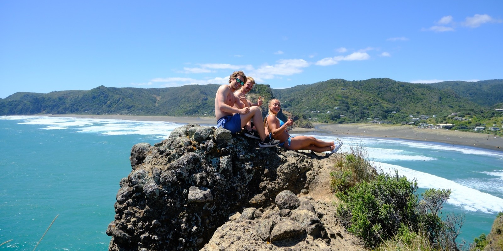
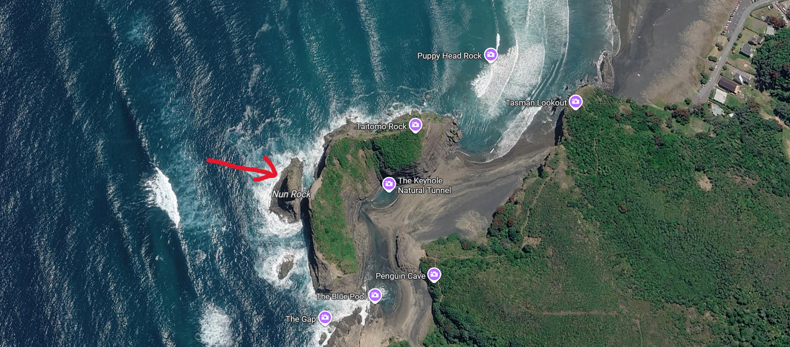
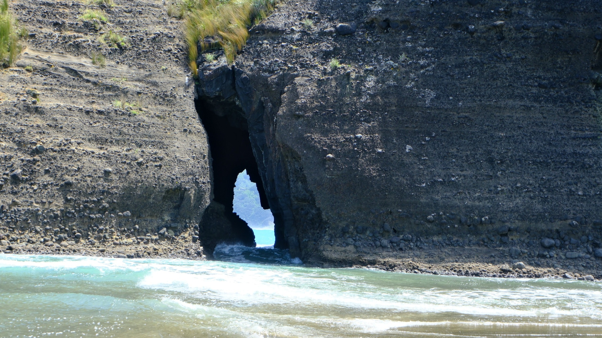

# Was at the beach today

I was at the beach today. It was quite nice. I assume most have been at the beach before, but if there was any doubt, I can assure that I have swum, drunk soda, listened to music and played volleyball. You don't really need much more. A cold beer would have been nice, but there was sadly no fridge nearby.

The beach is called Piha, and you're supposedly able to jump from a cliff here:

But the waves were too big, so we couldn't swim across. We're talking pulverized within ten seconds. So we dropped it.

