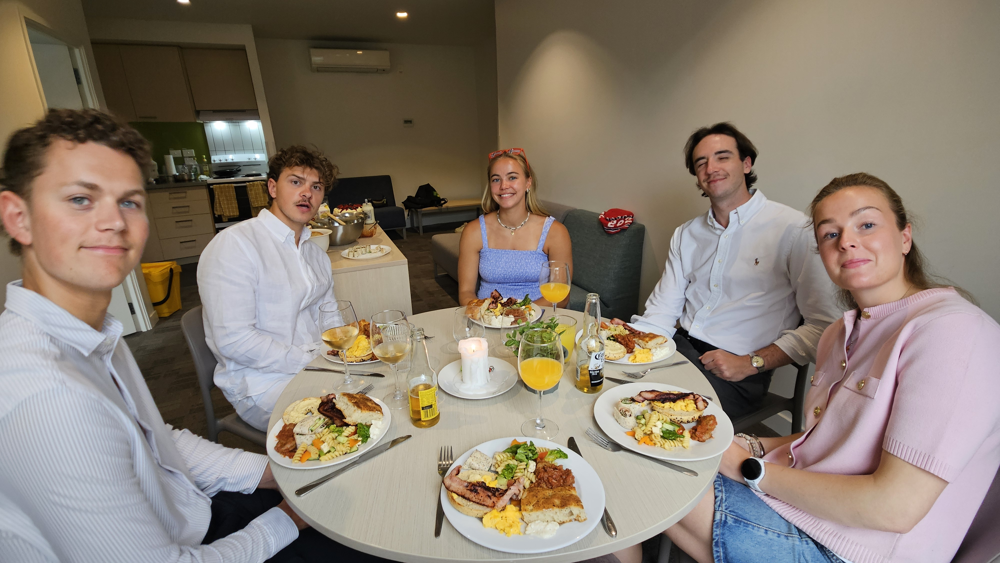

# Gratulerer med halvtårsdagen

Siden alt er opp ned i New Zealand, vil november være mai og mai være november. Det betyr at 17. november i New Zealand egentlig er 17. mai i Norge. Så da er det bare én ting å si: 

NORGE!!! Gratulerer med halvtårsdagen!!   🔴⚪🔵⚪🔴

Vi feiret tradisjonen tro med champagnefrokost, som man gjør

Han svenske kisen lengst til høyre var svært imponert og sa at han skulle si fra seg sitt svenske pass og prøve å bli norsk i stedet. Norje er jättemycket betre enn Sverige ugonsett, kvarfor skal jag inte barra bli norska forut som sist, sa han

Jeg vil kalle det en suksess. Og så dro vi på karaoke på kvelden:)