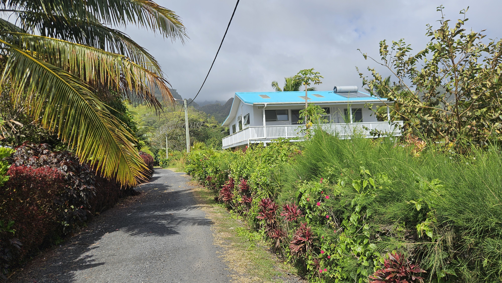
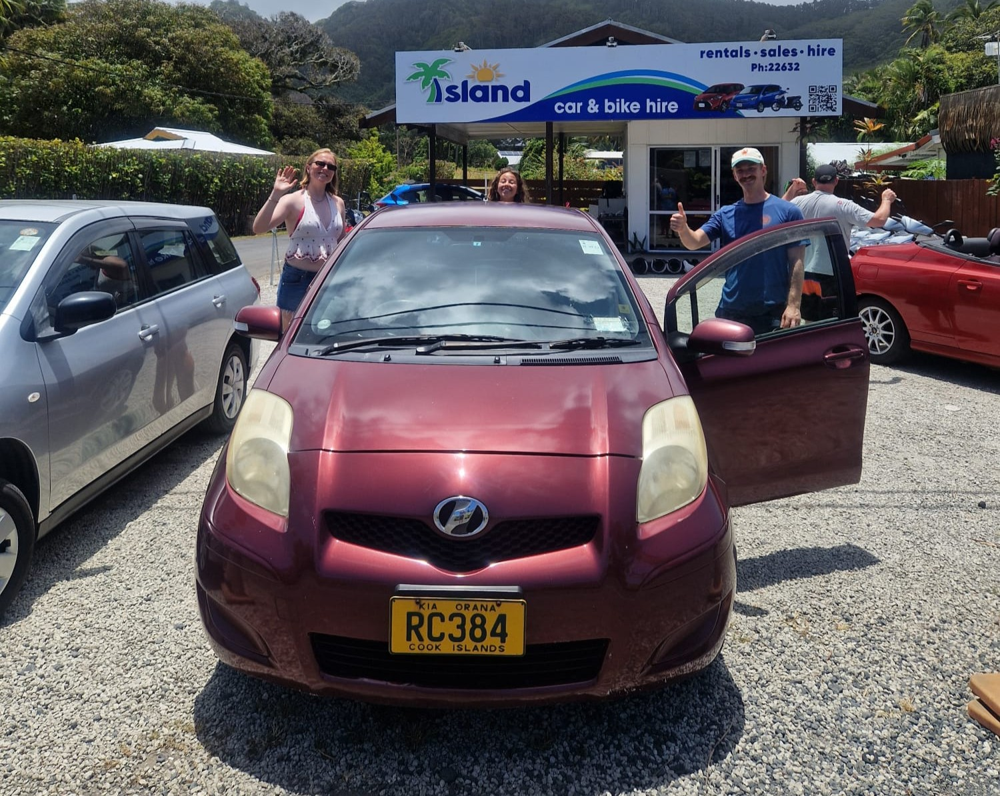
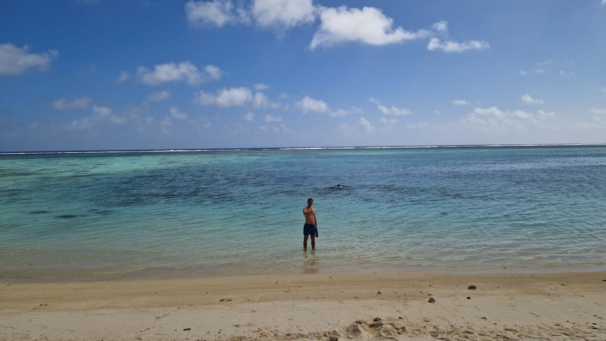

# Jeg er på ferie

I går fløy jeg til Cookøyene. Her skal jeg feriere med nordmennene Brage og Astri, og nederlenderen Amelie. Vi fløy bare til én av øyene, men det er nå dette Utenrikdsdepartementet kaller stedet. Flyet vårt lettet lørdag rundt 1530 lørdag Auckland tid, og vi landet fredag kveld i Cookøyene. Få det til å gi mening. Da var det mørkt, så det var ikke all verdens å se. Vi tok derimot verdens mest skranglete buss til sånn omtrent der hvor airbnben vi skulle bo i var.

Lørdag morgen ble vi vekket av en hane som sa kykkeliky. Mange ganger. Og høyt. Det var hyggelig. Landlig stemning.

Ryktene sier at Cookøyene er ganske turistifisert, men det kjenner ikke vi så mye på, spesielt ikke når stedet vi bor ser ut som dette. Jeg lover det ikke er Google Street View, jeg tok faktisk bildet selv.

Naboer inkluderer en okse i bånd, noen hunder uten bånd, et par fjærkre, og en liten åkerlapp. 

Dagens eneste gjøremål var å leie bil. Ja ja, det er mer øystemning med moped, men vi lot praktikalitet og pris seire. For eksempel trenger vi TO (2) edru personer dersom vi skal kjøre på bar med moped. Uakseptabelt. Da ble det bil. Det fikk vi til etter tre forskjellige bankkort og ni avviste transaksjoner. Men det var verdt det, når kjerren er en 2005 Toyota Vitz. Vedder på at du aldri har kjørt en sånn en før.

Etterpå snorklet vi litt. Vannet var varmt og kald litt om hverandre og fiskene var fine. Om noen har sett Nemo og husker sjefen i det akvariet, så det du hvordan hvertfall en av fiskene så ut. 

Og så dro vi på bar. Men vi gikk dit, så det hadde liksom ikke all verdens å si med den bilen. Kanskje vi får bruk for den i morgen. 

God natt, bloggen. Ses senere