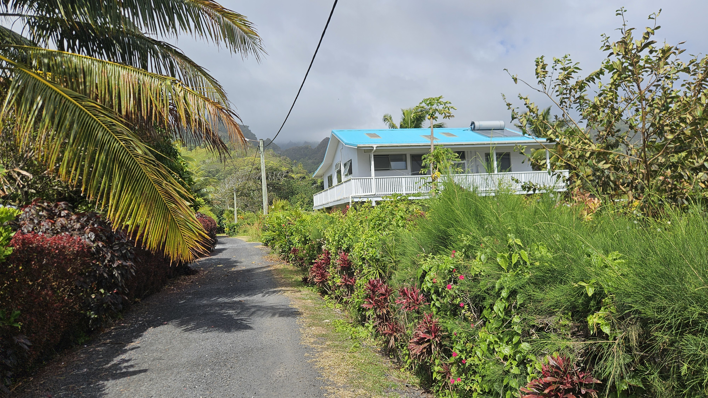
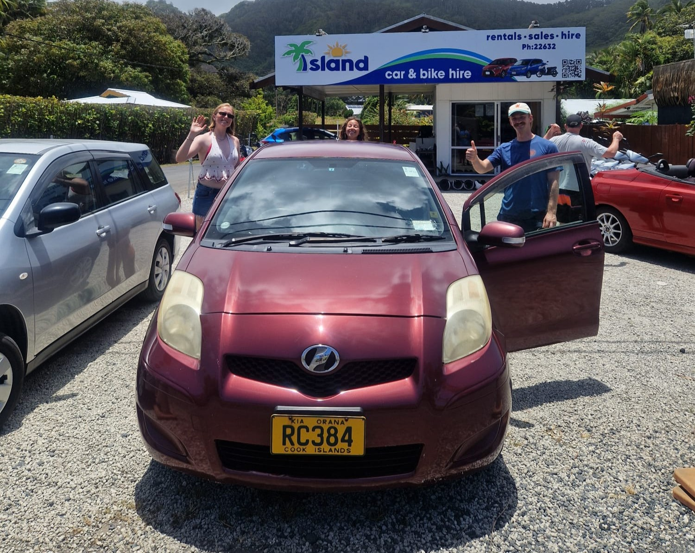
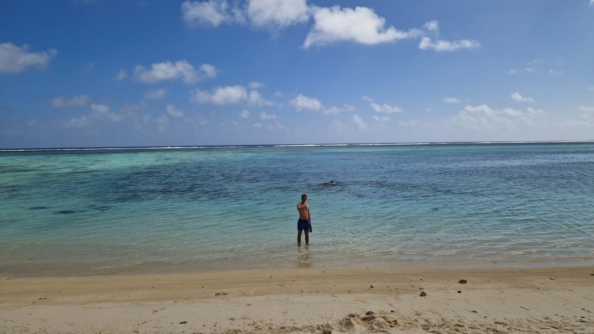

# I'm on vacation

Yesterday I flew to the Cook Islands. Here I will be on vacation with the Norwegians Brage and Astri and Dutch Amelie. We flew to only one of the islands, but this is what the Ministry of Foreign Affairs calls this place. The plane took off from Auckland around 1530 Satuday, and we landed Friday evening in the Cook Islands. Make it make sense. Then it was dark, and not much to see. In the other hand, we took the world's most rattly bus to around approximately where our AirBnB was.

Saturday morning we were woken by a rooster saying cock-a-doodle-do. Multiple times. And loudly. That was nice. Rural vibes.

Rumour has it the Cook Islands is quite touristy, but we don't really notice that when the palce we live looks like this. I promise this isn't Google Street View, I actually took this picture myself.

Our neighbours include a bull on a leash, some dogs without a leash, a couple poultry and a small field.

Our only plan for the day was to rent a car. Yes yes, it is more island vibez with a scooter, but pracitcality and price prevailed. We would for example need TWO (2) designated drivers we wanted to go to a bar our scooters. Unacceptable. Car it is. We finally managed this after three different bank cards and nine declined transactions. But it was worth it when the noble chariot is a 2005 Toyota Vitz. Bet you've driven one of those before. 

Afterwards we snorkled a bit. The water was warm and cold a bit intermittently and the fishes were pretty. If anyone has seen Finding Nemo and remembers the boss fish in the aquarium, then you at least know what one of the fish looks like.

And then we went to a bar. But we walked there, so it didn't really matter with that car. Maybe we'll find some use for it later.

Good night, the blog. See you later