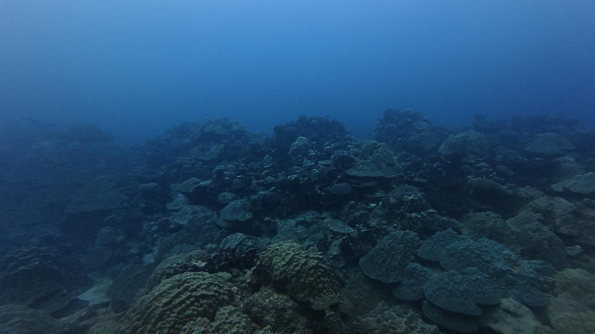
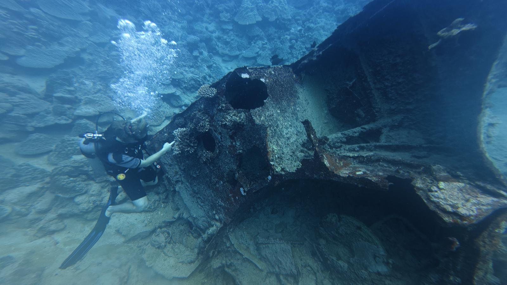
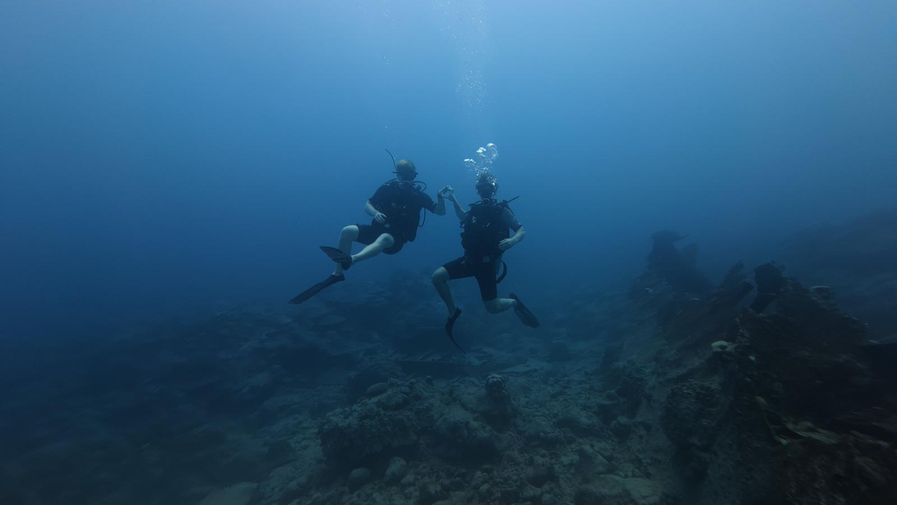
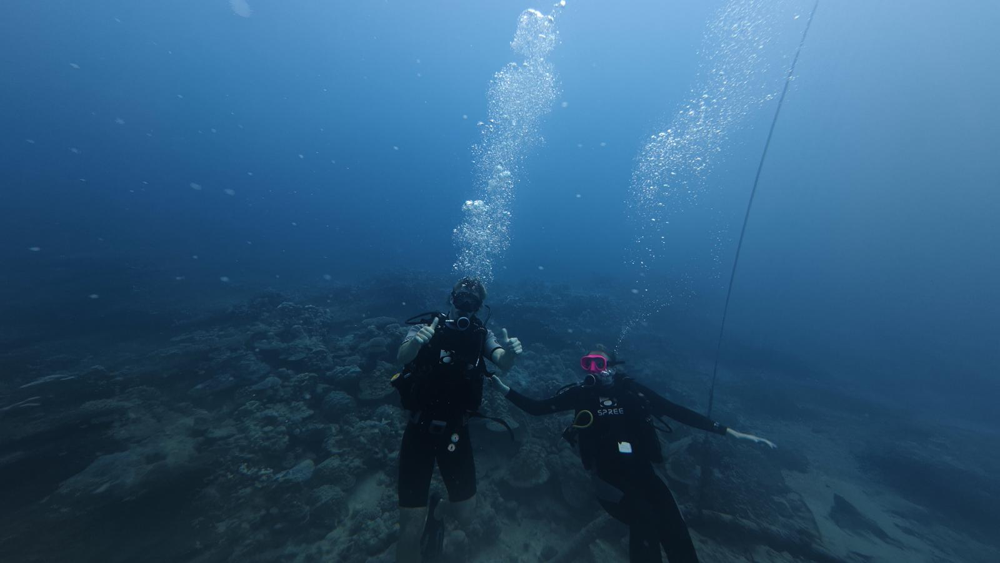

# Jeg har dykket

I dag gjorde jeg mitt første dykke-for-gøy-dykk i hele livet. De forrige har vært dykke-for-kurs-dykk, så åpenbart ikke like gøy. Det hjalp heller ikke at vannet var kaldt og fisketettheten var én fisk per kvadratkilometer. Men ikke i dag! Niks niks niks! I dag var vannet varmt og det var sånn minst femten fisk. Det var også en skilpadde, som er å se på bildet under. Det er litt sånn Hvor er Willy-stemning, så denne skilpadden er kun for den mest oppmerksomme leser!

Vi så også noe veldig merkelig på havbunnen. På bildet under peker jeg på det. Noen som  vet hva det er??? For dere som ikke kjenner min akademiske bakgrunn, så studerer jeg bølge, båt og data, som betyr at jeg med sikkerhet kan fastlå at dette er en båt, og at den IKKE fungerer som den skal!. Det er ikke meningen at den skal ligge på havbunnen. Båten gjør faktisk mest nytte på overflaten. Tenk så dårlige ingeniører. De dummingene tror sikkert det lineariserte grenseverdiproblemet er ekte. Skrekk og gru

Disse bildene eksisterer takket være Brage, som tok med seg undervannskamera helt fra Norge. Her er vi. Shoutout

Og så var det veldig snilt av Astri å sende meg bildene som er brukt i dette blogginnlegget. Og nei, jeg vil ikke dobbelt opp til overflaten, jeg gjør to sånne 🤙🏼🤙🏼 kule håndsymbol. Slapp av. 

