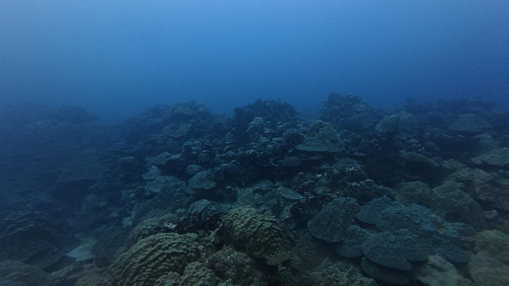
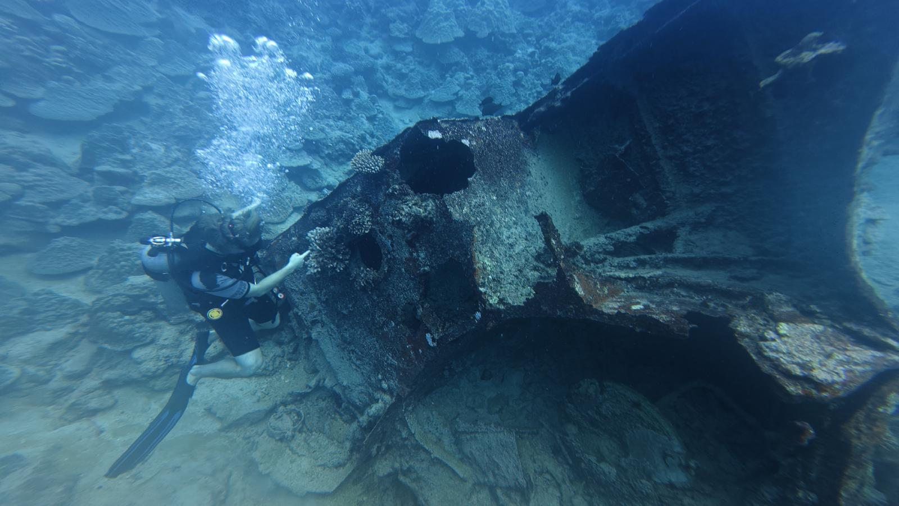
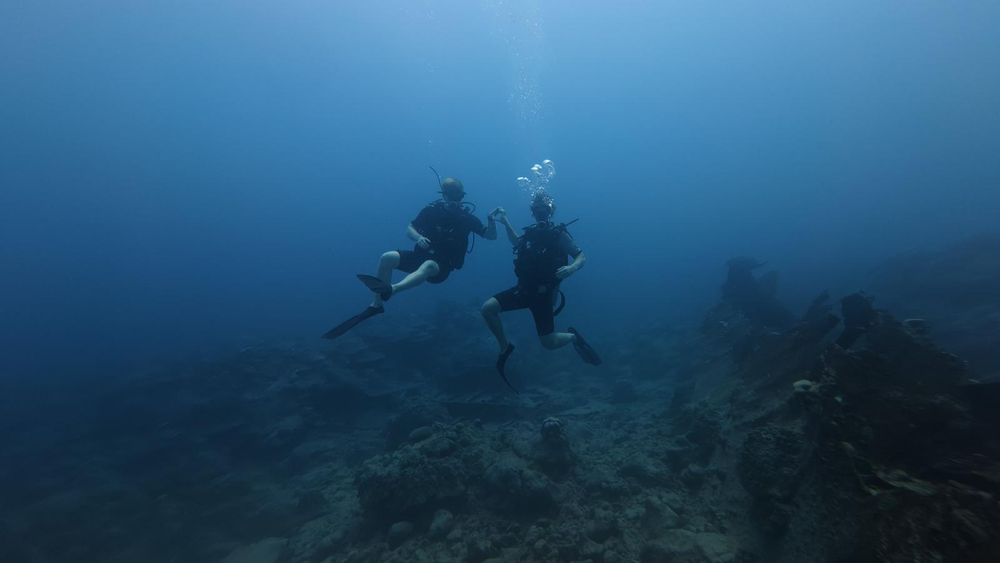
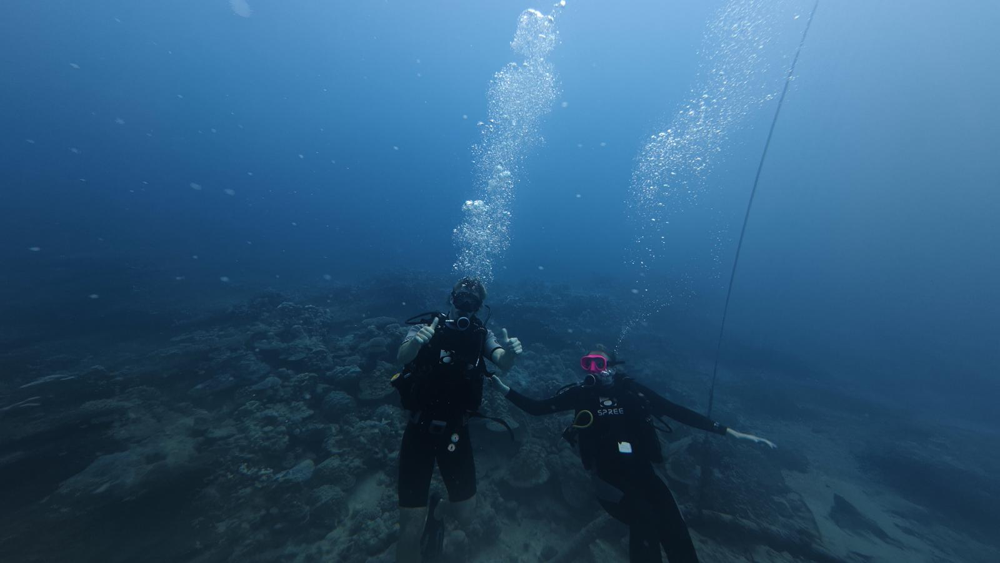

# I have dived

Today I did my first ever dive-for-fun-dive in my entire life. The previous have been dive-for-certification-dives, so obviously not as fun. It didn't help either that the water was cold and that the fish density was one fish each square kilometer. But not today! No no no! Today the water was warm and there was at least like fifteen fish. There was also a turtle, which can be seen in the picture below. It's kinda like Where's Waldo so this turtle is only for the most attentative reader!

We also saw something very strange on the sea bed. I point at it on the picture below. Does anyone know what it is??? For those of you who don't know my academic background, I study waves, boats and computers, and can therefore with confidence assert that this is a boat and that it does NOT work as it should! Boats are not supposed to lay on the ocean floor, they are way more useful on the surface. Such bad engineers. Those idiots probably even believe the linearized boundary value problem is real. Scary.

These pictures exist thanks to Brage, who brought his underwater camera all the way from Norway. Here we are. Shoutout.

It was also very nice of Astri to send me the pictures used in this blogpost. And no, I don't gesture double ascend, I make two of these 🤙🏼🤙🏼 cool hand signs. Relax a litte. 

