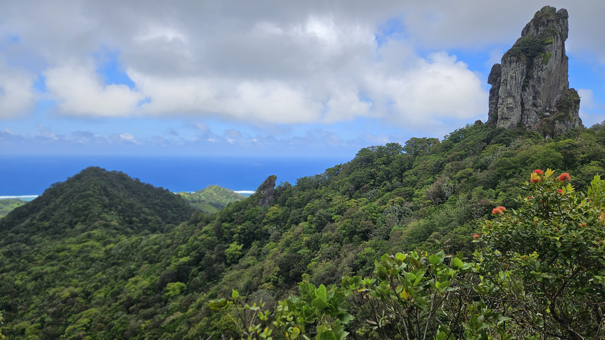
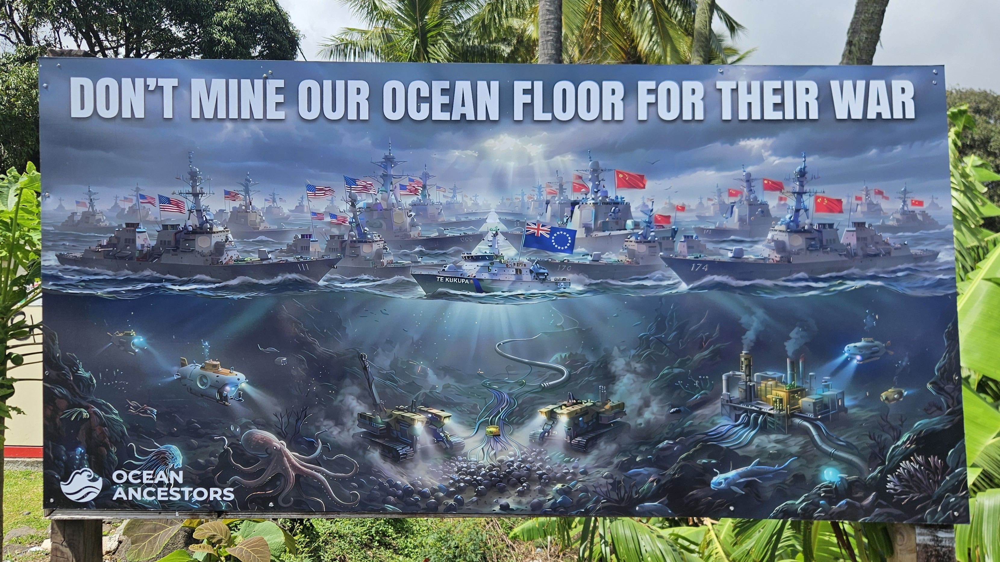

# Har gått på tur

Øyen vi bor på heter Rarotonga, og det er den største øyen i Cookøyene. Men det betyr ikke at den er spesielt stor; i dag gikk vi tvers over den, en tur som var omtrent 9 kilometer og 400 høydemeter. Og det var ganske fint. Utsikten er avbildet under. Toppen av turen var nede ved foten av markant stein på høyre side. Det er *mulig* med 15 meter free solo til toppen toppen, men vi var litt slitne i dag og hadde litt vondt i skulderen og så hadde det regnet litt dagen før og vi var litt sultne. Så neste gang.  

Men det var ikke egentlig utsikten som var høydepunktet med turen. Høydepunktet var dette skiltet, som vi så i løpet av den første kilometeren. Nådde toppen tidlig der ja.

Det er flere ting vi begynte å lure litt på mens vi sto og så på dette. Først lurte vi på hvordan kineserne fikk tak i jagere i Arleigh-Burke klassen. Tror ikke amerikanerne vil selge det til dem akkurat. Da må de vel være stjålet da. Så tenkte vi at det var en helt enorm blekksprut. Helt krakenstemning. Og driver de og forbrenner ting under vann borte til høyre der? Hvordan får de tak i oksygen til det? Skipet i midten der skal være Te Kukupa, som er Cookøyene sitt eneste militærlignende patruljeskip. Men det ser jo ikke sånn ut i det hele tatt??? Det har for eksempel ikke våpen. Helt urealistisk bilde jo.Budskapet om gruvedrift på havbunnen er greit da, men jeg er ikke helt frelst av AI-genererte plakater enda.