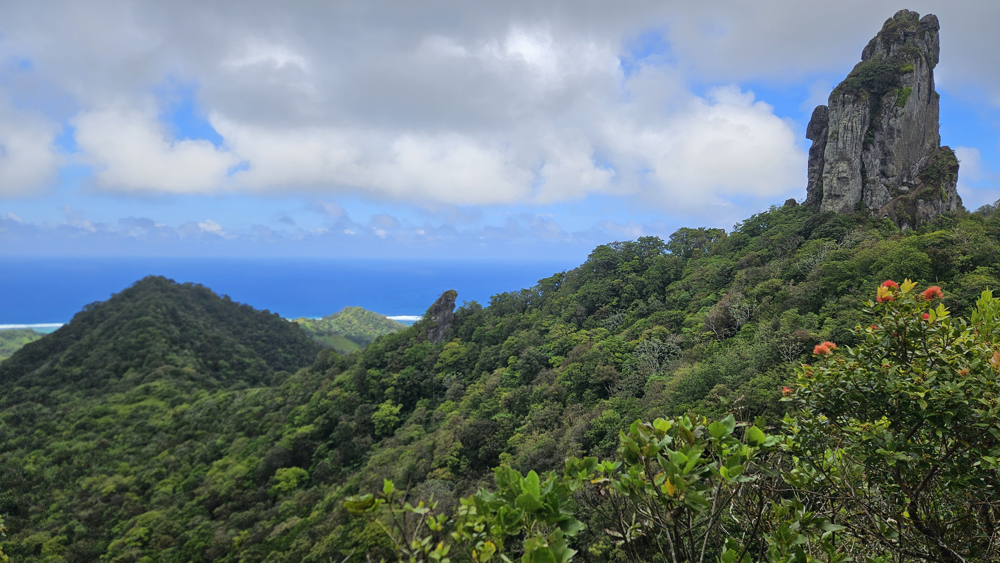
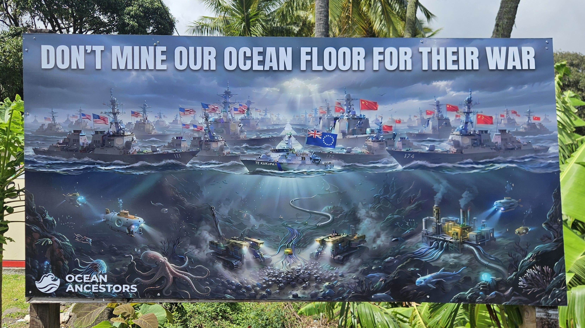

# Went on a hike

The island we live on is called Rarotonga, and it is the biggest island in the Cooks Islands. But that does not mean it is especially big. Today we walked across it, a hike that is approximately 9 km and 400 meters of elevation. And it was quite a nice hike. The picture below shows the view. The top of the hike was by the foot of the distinctive rock on the right side. It is *possible* to free solo to the top top, but we were a bit tired today and had some shoulder pain and it was raining yesterday and we were also a bit hungry. So next time.

But it wasn't really the view that was the highlight of the hike. The highlight was this sign, which we saw during the first kilometer. Reached the top early there.

There are multiple things we didn't understand about this sign. Firstly, we didn't understand how the Chinese got their hands on Arleigh-Burke class destroyers. Don't really think the Americans want to sell that to them. Guess they'll have to be stolen then. Then we thought that octopus was absolutely massive. Pure kraken. And are they burning things under water on the right there? How are they getting the oxygen for that? The ship in the middle is supposed to be Te Kukupa, which is the Cook Islands' only military looking patrol vessel. But it doesn't look like this at all??? For example, the real one doesn't have any weapons. Completely unrealistic picture. The message about mining on the sea bed is fine though, but I'm not 100 % convinced about AI-generated posters yet.