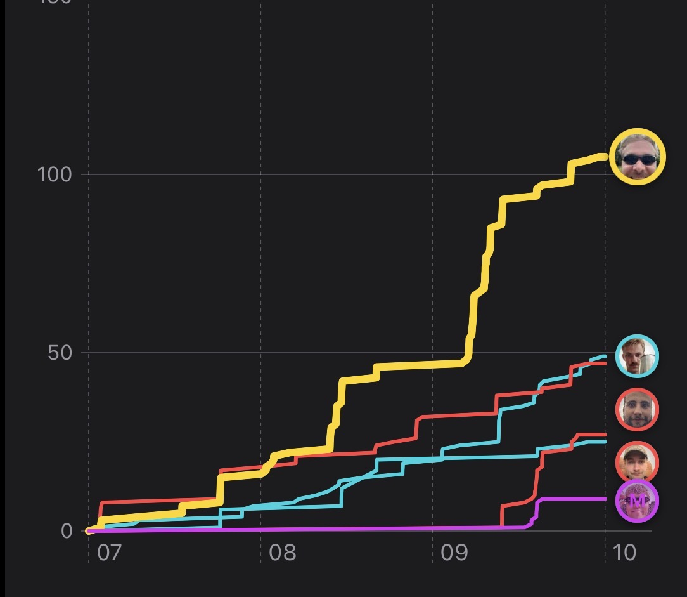
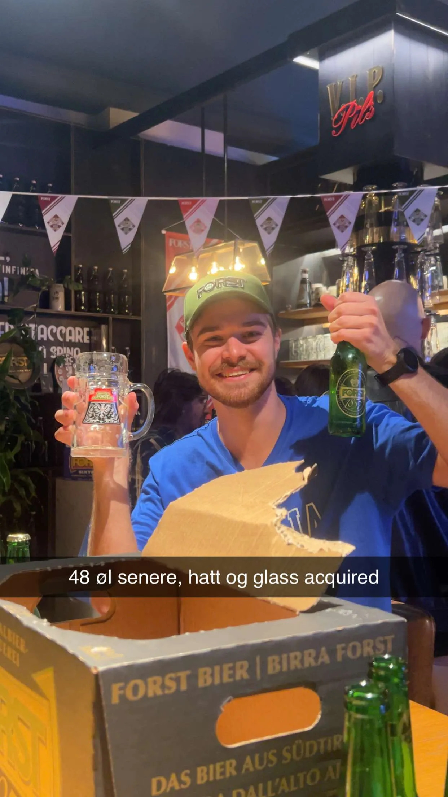
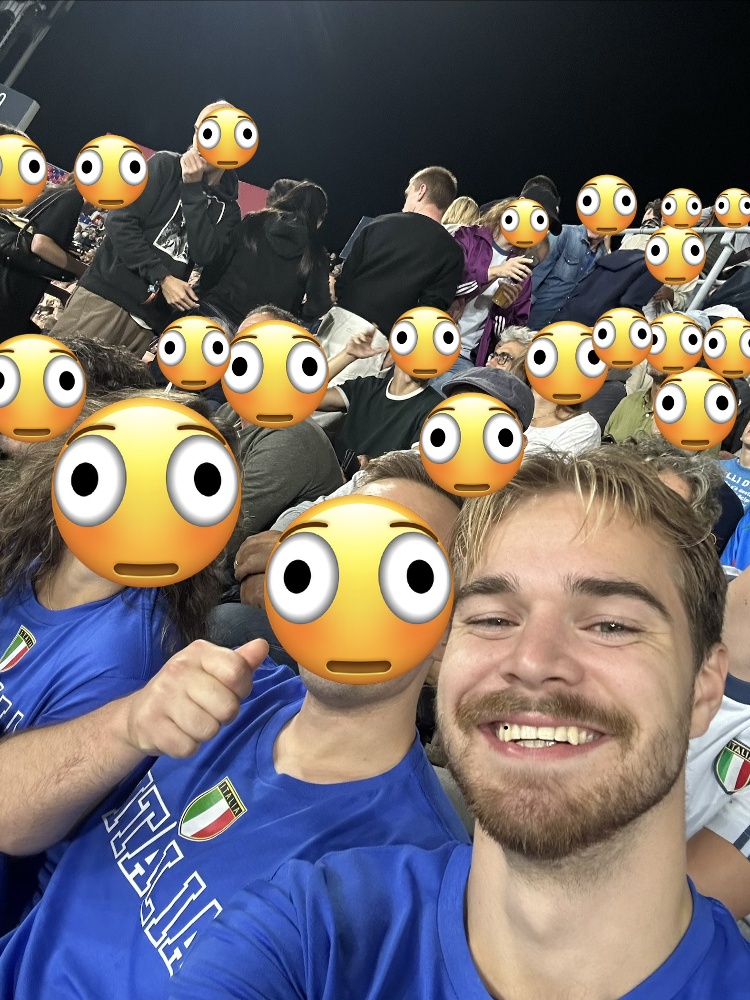

# Vi kan se Italia
Jeg skulle besøke noen venner jeg studerer med.

## Ta toget fra Napoli helt til Milano
Togsystemet i Italia er ganske rart. Det tok en time å komme seg fra flyplassen i Milan til Milan Sentralstasjon, som ikke nødvendigvis er hårreisenede. Det som var overraskende da var at toget fra Milano til Bologna også tok en time.

## Spise pasta min bror
Maten i Italia dasker fortsatt, de kan pizza der og pasta ragu (bolognaise) er jo fra Bologna, så det var også en vinner.

## Ta en skål for oss, hev et glass eller to (eller femti)
Jeg har, som Anders, for vane å dokumentere alkoholiseringen min på internett.  
Dere kan bli venner med meg [her](https://beerbuddy.app.link/stiancw?ch=copy_link&pl=friends).
På min uke i Italia var jeg en jævel på logging av øl, og viste virkelig vennene mine hvor skapet skulle stå.

Til mitt forsvar så hadde de veldig god og billig øl i Italia, og når de gir deg 48 øl gratis for prisen av en caps og et ølglass så må man jo nesten slå til. I tillegg har Italia min favoritt-øl, altså Peroni Gran Riserva (det er den røde Peronien hvis noen lurer).

## Så digg at alle på mitt lag er så målretta
Det var ingen bedre overskrift i den sangen for å beskrive at vi var på fotballkamp, men det var vi altså. Det italienske landslaget skulle spille mot Tyrkia, som jo lovet godt. Det var lættis og vi gikk full-kit wankers i Italia-skjorte fra turistbutikken.

## Vi kan (ikke) sette oss ved vannkanten
Mitt største problem med Bologna var at det ikke var noe strand. Det var rundt 20-25 grader om dagen og stort sett sol, men når det ikke er noe hav å bade i så må man  slå ihjel tid med å gå rundt å se på gammel stein og drikke øl. Misforstå meg rett, jeg liker både gammel stein og øl, men det hadde væert fint å ha et sted å legge seg ned også.

## Har ikke vært noe annet enn det var for fire år siden
Jeg trivdes godt i Bologna, det var fint og billig og jeg kunne godt levd "Ferie i Italia"-livet litt lenger.

