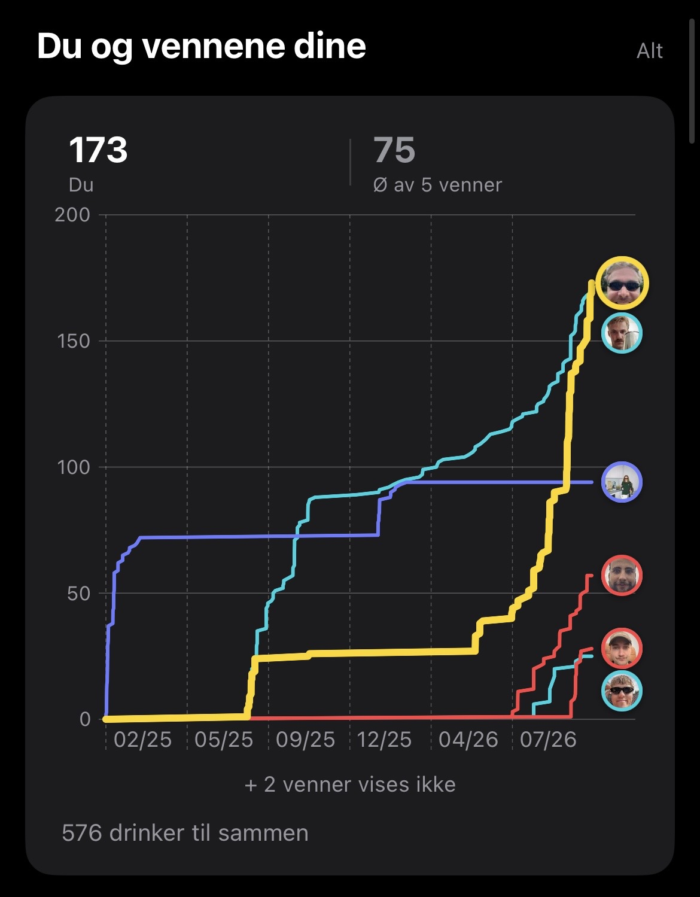
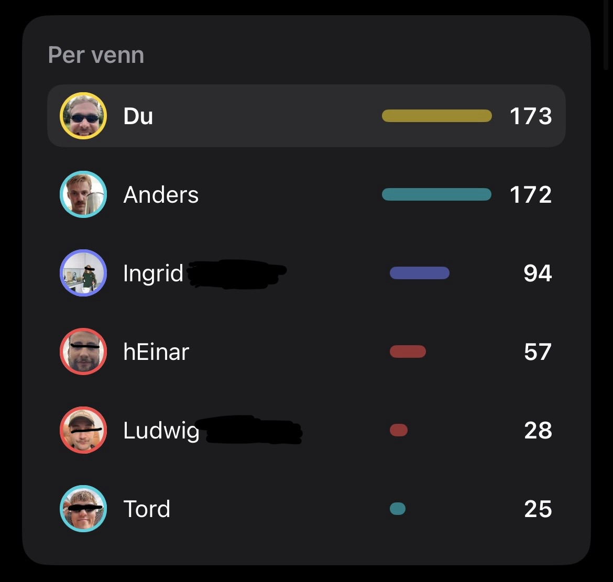

# Endelig

22 måneder,  
173 øl,  
ingen rom for feil.

Jeg er stolt av å kunne meddele at jeg endelig, etter lang lang tid har tatt igjen Anders i Beerbuddy appen. Det har krevd mye innsats og store investeringer, tid og offer, og ikke minst vilestyrke.

Jeg har måttet stå i det gjennom fester, sosiale sammenkomster, middager, vinsmakinger og konserter. Alltid har jeg måttet ha en øl i hånden, alltid har jeg måttet dokumentere det i appen.

Det jeg har lært av denne reisen er at det aldri lønner seg å gi opp. Selv om det ikke frister med øl nummer 8 på en onsdag, selv om man kanskje kunne drukket vann til tacomiddagen. Stå i det, ta den ølen, og hvis du er i utlandet: husk at det er monopolpenger.

Dette har vært en stor investering av tid og penger, men det er godt å se at man får lønn for strevet. Jeg har vokst på dette og gleder meg til å ta dere med videre på reisen.
